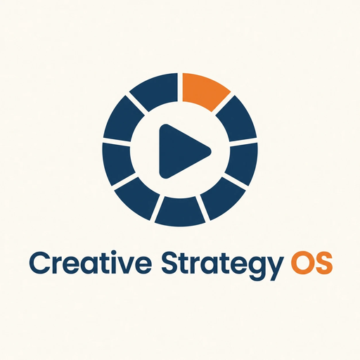

<p align="center"></p>

# Creative Strategy OS

Un stratège créatif senior dans Claude, pour vendre avec des pubs Meta et TikTok, en français : diagnostic, offre,
références qui ont déjà vendu, avatars, système de créatives, briefs prêts à produire, contrôle des vidéos, lancement,
lecture des résultats et variations.

**Ce plugin demande une licence.** Elle s'achète sur la boutique de Richie Tekan (Chariow). Une licence vaut pour
2 ordinateurs, à vie : un seul paiement, pas d'abonnement, les mises à jour comprises.

## Installer (une seule fois)

Dans Claude Code :

```
/plugin marketplace add https://github.com/tekanbidossessi-lab/creative-strategy-os.git
/plugin install creative-strategy-os@creative-strategy-os
```

Dans l'application Claude (onglet Code ou Cowork) : Paramètres, Plugins, Ajouter une marketplace, colle
`https://github.com/tekanbidossessi-lab/creative-strategy-os.git`, puis installe « creative-strategy-os ».

Ensuite, dis simplement à Claude : « je veux des pubs qui vendent pour mon produit ». À la première utilisation, il te
demande ta clé de licence (dans l'e-mail de Chariow) et l'enregistre sur ton ordinateur.

Il te faut aussi Python 3.11 ou plus récent (python.org). Claude vérifie le reste avec toi.

## Mettre à jour

**Rien à faire.** À ta première commande, le plugin active pour lui-même les mises à jour automatiques de Claude (il
te le dit en une ligne ; c'est le réglage « autoUpdate » de ta marketplace dans les paramètres de Claude). Ensuite,
chaque nouvelle version s'installe seule : Claude affiche « Plugin updated » et elle est active au démarrage suivant
(ou tout de suite avec `/reload-plugins`).

Chaque commande commence par le nom de ta version, par exemple « Creative Strategy OS 1.4.7 ». Si une version plus
récente existe déjà, la commande te le dit.

Pour mettre à jour tout de suite à la main : `/plugin marketplace update creative-strategy-os`, puis
`/reload-plugins`. Pour couper les mises à jour automatiques : `/plugin`, onglet **Marketplaces**,
`creative-strategy-os`, **Disable auto-update**. Rien à réinstaller, ta clé reste enregistrée. Les fiches de
méthode, elles, sont toujours à jour : elles viennent du serveur.

## Ce qui part sur internet, et ce qui reste chez toi

- **Reste sur ton ordinateur** : tes vidéos, tes images, tes clés (Apify, Gemini), tes mots de passe. Le
  téléchargement, la transcription, les images clés, le contrôle des vidéos et les documents Word/PDF se font chez toi,
  même sans réseau.
- **Part sur le serveur de licence** (pour les étapes de stratégie) : ta clé de licence, un identifiant de ton
  ordinateur (une empreinte, pas son nom), et les fichiers texte du dossier produit sur lequel tu travailles. Le serveur
  les traite dans un dossier temporaire, te renvoie le résultat et efface tout. Il ne garde qu'une ligne par commande :
  la date, la commande, ta clé masquée.

Le code de ce plugin est public : tu peux tout lire. Le fichier `csos_client.py` montre exactement ce qui est envoyé.

## Licence

Usage personnel, pour tes produits et ceux de tes clients. Ne partage pas ta clé : elle est liée à 2 ordinateurs, et
chaque fiche de méthode servie porte ton numéro de licence.
